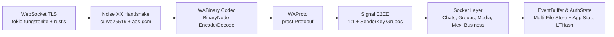

<div align="center">

# Baileys-Rust (`baileys-rs`)

**Port nativo en Rust puro de la librería WhatsApp Web Multi-Device (Baileys), diseñado para alto rendimiento, bajo consumo de memoria y ejecución directa en Android / Termux.**

[](https://github.com/LuferOS/Baileys-Rust/stargazers)
[](https://github.com/LuferOS/Baileys-Rust/network/members)
[](https://github.com/LuferOS/Baileys-Rust/issues)
[](https://github.com/LuferOS/Baileys-Rust)

[](Cargo.toml)
[](https://www.rust-lang.org/)
[](Cargo.toml)
[](https://termux.dev/)
[](src/Utils/generics.rs)

</div>

---

## Arquitectura del Proyecto



### Módulos Portados

| Módulo | Ruta en Rust | Responsabilidad |
| :--- | :--- | :--- |
| **WABinary** | `src/WABinary/` | Codificador/decodificador binario de nodos XML y manejo de JIDs (`@s.whatsapp.net`, `@g.us`, `@lid`, `@newsletter`). |
| **Crypto & Noise** | `src/Utils/crypto.rs`, `noise_handler.rs` | AES-GCM, AES-CBC, AES-CTR, HMAC-SHA256/512, HKDF, Curve25519/X25519, PBKDF2 y Noise XX en Rust puro. |
| **Signal** | `src/Signal/` | Sesiones E2EE 1-a-1, `SenderKey` para grupos, `LidMappingStore` y migración automática PN/LID. |
| **Socket** | `src/Socket/` | Conexión, envío/recepción de mensajes, ACKs, recibos, grupos, comunidades, canales (Newsletter), Mex GraphQL, Business y USync. |
| **Media** | `src/Utils/messages_media.rs` | Cifrado/descifrado AES-256-CBC + HMAC, subida a `mmg.whatsapp.net`, descarga por rangos y media retry. |
| **App State & Sync** | `src/Utils/chat_utils.rs`, `lt_hash.rs`, `history.rs` | LTHash anti-tampering, parches/snapshots cifrados, sincronización de historial comprimido con zlib y `EventBuffer`. |
| **WAM** | `src/WAM/` | Codificador binario de telemetría WAM v5 con catálogo completo de eventos y atributos globales. |

---

## Instalación y Configuración

### 1. Requisitos previos en Termux (Android)

```bash
pkg update && pkg upgrade -y
pkg install -y rust protobuf git pkg-config ffmpeg
```

### 2. Requisitos previos en Linux (Debian / Ubuntu)

```bash
sudo apt update
sudo apt install -y curl git build-essential protobuf-compiler ffmpeg
curl --proto '=https' --tlsv1.2 -sSf https://sh.rustup.rs | sh
```

### 3. Clonar y verificar compilación y pruebas

```bash
git clone https://github.com/LuferOS/Baileys-Rust.git
cd Baileys-Rust
cargo test
```

### 4. Agregar como dependencia en tu proyecto (`Cargo.toml`)

```toml
[dependencies]
baileys-rs = { git = "https://github.com/LuferOS/Baileys-Rust.git", branch = "main" }
tokio = { version = "1", features = ["rt-multi-thread", "macros"] }
```

> **Nota sobre TLS en Termux:** Este proyecto utiliza `rustls` con el backend criptográfico `ring` y certificados `webpki-roots` embebidos tanto en `tokio-tungstenite` como en `reqwest`. No necesitas compilar ni enlazar `openssl-sys` ni dependencias nativas de C para TLS.

---

## Antes en Node.js (Baileys TS) vs Ahora en Rust (`baileys-rs`)

### Comparativa Técnica

| Característica | Baileys (Node.js / TypeScript) | Baileys-Rust (`baileys-rs`) |
| :--- | :--- | :--- |
| **Runtime** | Node.js / V8 + Garbage Collector | Binario nativo compilado (sin GC) |
| **Consumo de RAM base** | ~90 MB - 250 MB en reposo | ~10 MB - 25 MB en reposo |
| **Criptografía** | OpenSSL / Node `crypto` + puentes nativos | Crates puros en Rust (`aes-gcm`, `curve25519-dalek`, `hkdf`) |
| **TLS / HTTPS** | OpenSSL del sistema | `rustls` + `ring` con raíces `webpki` embebidas |
| **Protobuf** | `protobufjs` en tiempo de ejecución | `prost` generado en compilación (`build.rs`) |
| **Concurrencia** | Event loop monohilo + promesas | `tokio` multihilo con mutex tipados y canales `broadcast` |
| **Seguridad y tipado** | Validación en transpilación TS; errores en runtime | Seguridad de memoria y tipos estrictos en compilación |

### Ejemplo 1: Cargar credenciales y obtener última versión de WhatsApp Web

**Antes en Node.js (TypeScript):**

```ts
import { useMultiFileAuthState, fetchLatestWaWebVersion } from '@whiskeysockets/baileys'

async function init() {
	const { state, saveCreds } = await useMultiFileAuthState('auth_info')
	const { version, isLatest } = await fetchLatestWaWebVersion()
	console.log({ version, isLatest, regId: state.creds.registrationId })
}
```

**Ahora en Rust (`baileys-rs`):**

```rust
use baileys_rs::utils::{fetch_latest_wa_web_version, use_multi_file_auth_state};

#[tokio::main]
async fn main() -> Result<(), Box<dyn std::error::Error>> {
    let auth = use_multi_file_auth_state("auth_info").await?;
    let wa_ver = fetch_latest_wa_web_version(Some(10_000)).await;
    println!(
        "version={:?} latest={} reg_id={}",
        wa_ver.version, wa_ver.is_latest, auth.creds.registration_id
    );
    Ok(())
}
```

### Ejemplo 2: Cifrado y descifrado de archivos multimedia

**Antes en Node.js (TypeScript):**

```ts
import { encryptedStream } from '@whiskeysockets/baileys'

const media = await encryptedStream(Buffer.from('datos-imagen'), 'image')
console.log(media.mediaKey, media.fileEncSha256, media.fileLength)
```

**Ahora en Rust (`baileys-rs`):**

```rust
use baileys_rs::defaults::MediaType;
use baileys_rs::utils::{decrypt_media_bytes, encrypt_media_bytes};

fn media_roundtrip() -> Result<(), Box<dyn std::error::Error>> {
    let raw = b"datos-imagen";
    let encrypted = encrypt_media_bytes(raw, MediaType::Image)?;
    let decrypted =
        decrypt_media_bytes(&encrypted.encrypted, &encrypted.media_key, MediaType::Image)?;
    assert_eq!(decrypted, raw);
    Ok(())
}
```

### Ejemplo 3: Gestión de grupos y recepción de eventos

**Antes en Node.js (TypeScript):**

```ts
const metadata = await sock.groupMetadata('12036300012345@g.us')
await sock.groupUpdateSubject(metadata.id, 'Grupo en Node')

sock.ev.on('messages.upsert', ({ messages }) => {
	for (const msg of messages) {
		console.log(msg.key.remoteJid)
	}
})
```

**Ahora en Rust (`baileys-rs`):**

```rust
use baileys_rs::socket::{MessagesRecvSocket, RecvEvent, WaSocket};

async fn handle_groups_and_events(
    socket: &WaSocket,
    recv: &MessagesRecvSocket,
) -> Result<(), Box<dyn std::error::Error>> {
    let meta = socket.group_metadata("12036300012345@g.us").await?;
    socket.group_update_subject(&meta.id, "Grupo en Rust").await?;

    let mut rx = recv.subscribe();
    while let Ok(event) = rx.recv().await {
        if let RecvEvent::MessageUpsert { message, .. } = event {
            println!("{:?}", message.key.remote_jid);
        }
    }
    Ok(())
}
```

---

## Cosas Importantes

- **Rendimiento de compilación en Termux (`/sdcard` vs `$HOME`):** El almacenamiento compartido (`/sdcard`) tiene I/O más lento y restricciones POSIX. Para compilar mucho más rápido en Android, exporta el directorio `target/` hacia tu espacio interno de Termux:
  ```bash
  export CARGO_TARGET_DIR=$HOME/.cargo-target
  ```
- **Sincronización de la versión de WhatsApp Web:** WhatsApp rechaza conexiones que anuncien revisiones muy antiguas. Usa siempre `fetch_latest_wa_web_version` al iniciar tu cliente en lugar de depender únicamente de la versión de respaldo.
- **Integridad de la carpeta de sesión (`auth_info`):** No borres archivos sueltos dentro de la carpeta de autenticación mientras existan sesiones Signal activas. Hacerlo desincroniza los ratchets E2EE y provoca errores `BadMac` o reintentos continuos.
- **Dependencia opcional de `ffmpeg`:** La extracción de miniaturas de video (`extract_video_thumb`) ejecuta `ffmpeg` del sistema. Instálalo si tu bot enviará videos con vista previa.
- **Aviso de responsabilidad:** Este proyecto es una implementación independiente y no está afiliada, respaldada ni autorizada por WhatsApp LLC ni Meta. Úsalo bajo tu propia responsabilidad y evita envíos masivos o automatizaciones abusivas que puedan derivar en bloqueos de cuenta.

---

## Versiones y Compatibilidad

| Componente | Versión / Estado |
| :--- | :--- |
| **Crate (`baileys-rs`)** | `0.1.0` |
| **Rust Edition** | `2021` (recomendado `rustc >= 1.82`) |
| **Protocolo WhatsApp Web** | `2.3000.1043857760` (actualizable dinámicamente vía `sw.js`) |
| **Arquitecturas probadas** | `aarch64-linux-android` (Termux), `x86_64-unknown-linux-gnu` |
| **Compilación de Protobuf** | Automática mediante `build.rs` + `prost-build` |

---

## Reportar Problemas

¿Encontraste un fallo de compilación, un nodo binario mal decodificado o un problema con sesiones Signal/Grupos? Puedes abrir un reporte directamente en GitHub:

**[Abrir un nuevo Issue en LuferOS/Baileys-Rust](https://github.com/LuferOS/Baileys-Rust/issues/new)**

Para resolverlo rápido, incluye en tu issue:

1. **Entorno y versiones:** salida de `rustc --version`, `cargo --version` y sistema operativo (por ejemplo, Termux en Android o Ubuntu).
2. **Módulo afectado:** `WABinary`, `Signal`, `Socket`, `Media`, `AppState` o `WAM`.
3. **Traza del error:** salida completa de `RUST_BACKTRACE=1 cargo test` o el log JSON generado por `BaileysLogger`.
4. **Pasos para reproducir:** fragmento mínimo de código y tipo de chat involucrado (`@s.whatsapp.net`, `@g.us`, `@lid` o `@newsletter`).

---

## Estrellas y Gráfica del Proyecto

Si este port te sirve para correr bots ligeros en Termux o servidores Linux, deja tu estrella en el repositorio para apoyar el desarrollo.

<div align="center">

[](https://star-history.com/#LuferOS/Baileys-Rust&Date)

</div>
